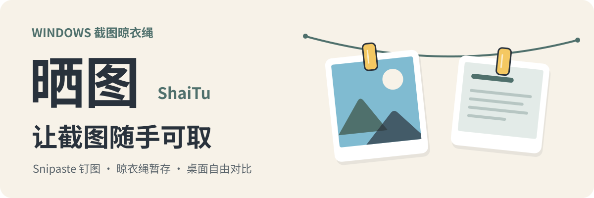
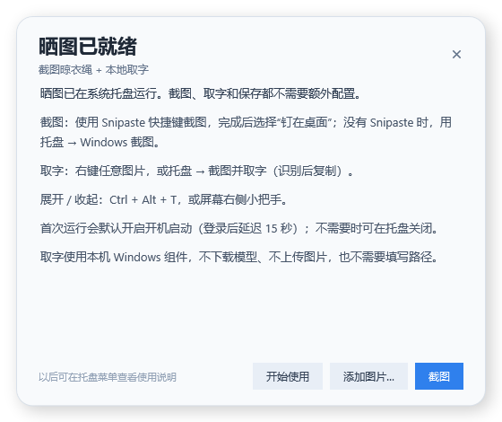

<p align="center">
  
</p>

# 晒图 · ShaiTu

把截图挂到桌面晾衣绳上，随手复制、取字和排序。支持 Snipaste 钉图联动，也能使用 Windows 自带的截图工具；文字识别在本机完成，不上传图片。

**Windows 10 1903+ / Windows 11（64 位）· .NET Framework 4.8 · 便携版，无需安装**

> **开箱即用：** 解压后双击 `ShaiTu.exe` 即可；不需要安装 Snipaste，也不用填写 OCR 路径。取字使用 Windows 自带能力，详见下文“识别引擎”。


*程序实际渲染的界面，使用示例图片。*

## 为什么是晒图

- **截图不该散落桌面**：最多暂存 8 张，新图从左侧进入，溢出时清理最右侧；清空或退出只清理晒图缓存。
- **取字不该上传**：Windows 11 自动使用系统更准确的 OCR，其他系统使用 Windows OCR，图片和识别结果都留在本机。
- **Snipaste 照常使用**：只接收最终钉在桌面的截图；桌面贴图仍可自由拖动、缩放和对比，晒图负责取用和取字。
- **解压即用**：不需要填写 Snipaste 路径或 OCR 模型路径；取字组件自动检测，首次运行后默认开启开机启动，可在托盘关闭。

## 功能

- **截图晾衣绳**：左键复制图片，右键打开取字窗口，Shift + 右键打开更多操作；拖动交换位置，拖出取下。
- **本地取字**：右键、图片菜单或托盘“截图并取字”，支持拖选、全选、编辑全文和重新识别。
- **Snipaste 联动**：自动接收最终钉图，保留 Snipaste 桌面贴图；直接复制不上绳。
- **Windows 截图后备**：Snipaste 未运行时，托盘入口自动切换到 Windows 截图。
- **轻量交互**：自动隐藏、右侧小把手、全局展开快捷键、开机启动、剪贴板/文件夹接收。

## 开始使用

1. [下载最新便携版 ZIP](https://github.com/weidaozhong/ShaiTu/releases/latest)，完整解压到固定文件夹。
2. 运行 `ShaiTu.exe`，保留同目录的 `ShaiTu.exe.config`。平时程序在任务栏托盘运行。
3. 首次启动会出现“晒图已就绪”引导窗口，可直接截图或添加图片，也可以点“开始使用”留在托盘。
4. 截一张图，或在托盘中选择“添加图片”。图片保存后，晾衣绳自动展开确认至少 5 秒。



> 解压后的 ZIP 已包含运行所需的 exe、配置和说明；不需要填写 Snipaste 路径或 OCR 模型路径。首次运行后默认开启开机启动，可在托盘关闭。

**使用 Snipaste：** 使用已经设置好的截图快捷键，完成截图或编辑后选择“钉在桌面”。晾衣绳只接收最终钉图，直接复制不上绳，编辑前的原图也不会额外加入。

**使用 Windows 截图：** Snipaste 未运行时，托盘截图入口自动切为“Windows 截图”。点击后选取区域，结果自动上绳。系统截图工具需要将结果复制到剪贴板；Esc 取消，未完成的接收在 2 分钟后结束。

Snipaste 启动后，托盘菜单切回它的截图入口，并读取当前快捷键设置。自动检测不到贴图目录时，可在托盘中选择 Snipaste 安装目录或 `history` 目录。

## 文字识别

常用入口：

| 入口 | 行为 |
| --- | --- |
| **右键图片** | 打开取字窗口，自动识别并显示文字 |
| **Shift + 右键 → 复制文字** | 后台识别，直接把全文复制到剪贴板，不打开窗口 |
| **Shift + 右键 → 提取文字…** | 打开取字窗口 |
| **托盘 → 截图并取字（识别后复制）** | 用 Snipaste 或 Windows 截图，图片上绳后自动识别并复制全文 |

注意：直接用 Snipaste 截图/钉图不会自动 OCR；需要取字时右键图片，或从托盘使用“截图并取字”。

**取字窗口：**

- 自动开始识别，显示原图、词数和行数；没有常驻的蓝色词框。
- 在文字上拖动可选中词语，`Ctrl + A` 全选；只高亮选中的文字。
- 底部按钮：**重新识别**、**编辑全文**、**全选**、**复制全部**、**复制选中**。
- “编辑全文”可以先修正识别结果，复制时优先使用修改后的全文。
- 点击窗口外会最小化到任务栏（与 `–` 一致）；拖动卡片边缘可调整大小。
- 没有全局取字快捷键；取字入口都在图片或托盘上。

**识别引擎（无需配置）：**

| 系统 | 识别方式 | 你需要做什么 |
| --- | --- | --- |
| Windows 11，系统提供高精度 OCR | 自动使用系统组件，识别质量更好 | 无 |
| Windows 10，或其他情况 | 自动使用 Windows OCR | 无 |

- 打开取字窗口或点“复制文字”就会自动识别；不需要安装 OCR、不用下载模型、不用填写路径，也不会上传图片。
- 应用会自动选择可用引擎；两种方式都能取字，区别只是识别质量。
- 发布包只包含晒图程序本身；识别能力来自 Windows，所以不需要额外安装文件。

> 为什么 ZIP 里没有 OCR 文件？Windows 已自带 OCR，晒图直接调用系统能力，避免重复打包上百 MB 的引擎；你不需要另外安装或配置。


## 图片怎么用

| 操作 | 结果 |
| --- | --- |
| 左键单击 | 复制图片，并显示“已复制” |
| 右键单击 | 打开取字窗口（图片同时作为大图查看） |
| Shift + 右键 | 打开更多操作菜单；左键点击菜单外关闭 |
| 复制文字 / 提取文字… | 后台复制文字 / 打开取字窗口 |
| 拖到另一张图片上 | 两张图片交换位置 |
| 拖出挂绳区域后松手 | 取下图片并清理对应缓存 |
| 拖拽时按 Esc | 取消拖拽，图片保留 |
| 上下拖动绳子 | 调整高度，松手后记住位置 |
| 长按图片 | 用画图编辑 |
| 菜单 → 另存为 | 保存一份需要长期保留的图片 |

## 排列与清理

新图片从**左侧**挂入，原有图片向右移动。最多暂存 **8 张**，满了再加入时，清理**当前最右侧**的一张及其晒图缓存。

没有手动交换位置时，最右侧就是最早加入的图片；拖拽排序会改变清理顺序。

拖给其他应用后，或在绳外没有接收目标的区域松手，同样会清理绳上的对应缓存。清空晾衣绳或从托盘退出会清理全部暂存图片；强制结束进程不会执行退出清理。

这些操作只清理晒图缓存，保留 Snipaste 桌面贴图、原文件和你另存的图片。需要长期保留的图片，请使用“另存为”。

## 展开与收起

- **没有图片：** 绳子和右侧小把手都隐藏。
- **有图片时：** 右侧小把手始终显示，晾衣绳展开时也在。展开时点击 `›` 立即收起；隐藏时点击 `‹` 展开，悬停 0.3 秒也可展开。
- **取用图片时：** 鼠标留在图片、绳子及附近缓冲区域内保持显示，离开 0.6 秒后收起。拖拽、调高度和打开菜单时保持显示。
- **主动展开后：** 通过快捷键或托盘展开会持续显示，再次主动收起才隐藏。

默认展开 / 收起键是 **Ctrl + Alt + T**，可在托盘中改为单键或组合键。它与截图快捷键分别设置。

## 托盘设置

- **截图：** 有 Snipaste 时调用它的截图入口；没有时使用 Windows 截图。
- **截图并取字：** 截图后自动识别并复制文字。
- **开机启动：** 首次运行后默认开启；登录 Windows 后延迟 15 秒运行，先保持隐藏。可在托盘关闭。移动程序后，手动运行一次以更新启动路径。
- **接收剪贴板图片：** 默认关闭，可开启以接收其他应用复制的图片；Snipaste 的直接复制仍不上绳。
- **监听文件夹：** 自动接收所选文件夹中新生成的图片。
- **清空晾衣绳 / 清理截图并退出：** 清理暂存图片，保留高度、快捷键等设置。

暂存图片和设置位于 `%LOCALAPPDATA%\ShaiTu`。没有截图工具时，仍可使用“添加图片”、剪贴板接收或监听文件夹，正常复制、取字、查看、排序和另存。

## 版本说明

### 0.7.3

- 首次运行后默认开启开机启动（登录后延迟 15 秒）；不需要时可在托盘关闭。
- 保留 0.7.2 的首次引导、把手自动收起和零配置取字。

### 0.7.2

- 修复从右侧把手展开后晾衣绳不自动收起的问题：把手展开不再进入“手动保持”，离开后仍按 0.6 秒收起。
- 首次解压启动会显示使用引导，双击 exe 不再只有托盘图标。
- 发布包无需配置 Snipaste 或 OCR 路径：有 Snipaste 时联动钉图，没有时用 Windows 截图；取字使用本机 Windows 组件。

### 0.7.1

- 有图片时右侧小把手**始终显示**；晾衣绳展开时也能直接点它收起。
- 鼠标离开后的自动收起等待从 1.2 秒缩短到 **0.6 秒**。
- 把手图标随状态变化：展开时显示 `›`，隐藏时显示 `‹`。

### 0.7.0

- 新增本地取字、取字窗口和“截图并取字”。
- 标注和长截图功能已移除；现在专注于截图暂存与取字。

## 从源码构建

项目使用 C#、WPF 和 .NET Framework 4.8，通过系统自带的 `csc.exe` 编译，不依赖 NuGet 或 Windows SDK。

要求：

- 64 位 Windows 10 1903+ 或 Windows 11；
- .NET Framework 4.8；
- 系统 `WinMetadata`（Windows 10 1809+ 自带，1903+ 已包含 .NET 4.8）。

```powershell
# 构建到 dist，并运行 103 项自动检查
powershell -NoProfile -ExecutionPolicy Bypass -File .\build.ps1 -Test

# 打包便携版 ZIP 和 SHA256
powershell -NoProfile -ExecutionPolicy Bypass -File .\scripts\package-release.ps1 -Version 0.7.3
```

推送 `v*` 标签会触发 [Windows 自动构建与发布](https://github.com/weidaozhong/ShaiTu/actions)，生成带 SHA256 的便携版 Release。

开发时可使用 `--self-test`、`--ocr-test`、`--workbench-test`、`--smoke-test`、`--welcome-test` 等命令行检查；`--ocr-test` 需要自备本地 OCR 样本。

## 许可证

本项目采用 [Apache License 2.0](./LICENSE)。第三方材料保留原有许可，详见 [第三方许可证声明](./THIRD-PARTY-NOTICES.txt)。

OCR 使用本机 Windows / Microsoft 截图工具提供的组件，本项目不重新分发这些组件；相关说明见第三方许可证声明。
